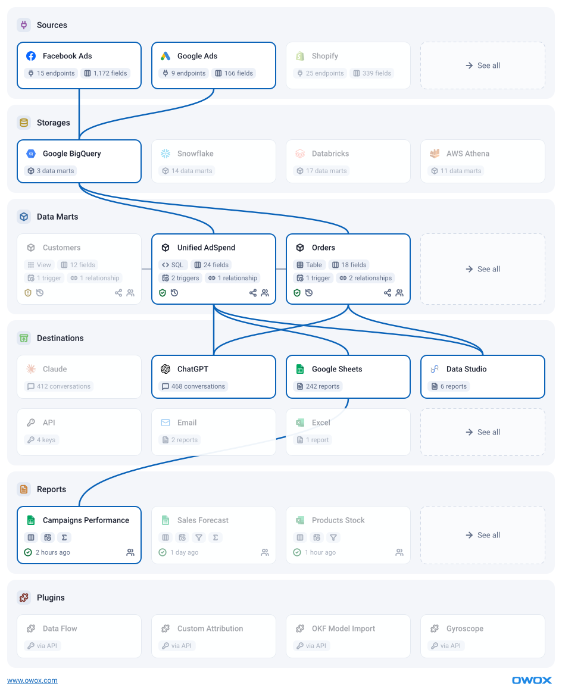

<!-- markdownlint-disable MD033 --  and <picture> give the icons and the light/dark diagram -->

# OWOX Data Marts — The Easiest Way to Give Every Teammate the Data They Need

## Free connectors and ontology-backed analytics without hallucinations

Plug your sources into ready-to-prompt ontology models and get hallucination-free analytics. Give teammates and AI agents joinable Data Marts in the tools they already know: API, CLI, MCP, Spreadsheets, Dashboards and more. No extra UI, no semantic-layer tax, no black boxes. No LLM writes the SQL behind a business user's answer, so nobody downstream gets a hallucinated number with your name on it.

[**📘 Quick Start Guide**](./docs/getting-started/quick-start.md) · [**📚 Docs**](https://docs.owox.com?utm_source=github&utm_medium=referral&utm_campaign=readme) · [**🌐 Website**](https://www.owox.com/product?utm_source=github&utm_medium=referral&utm_campaign=readme) · [**🆘 Issues**](https://github.com/OWOX/owox-data-marts/issues)

## Why OWOX Data Marts

1. **Zero hallucinations.** No LLM writes the SQL behind a business user's answer. Every answer resolves to your ontology model: Data Marts are the entities, [declared joins](./docs/getting-started/setup-guide/joinable-data-marts.md) are the relationships. A metric nobody defined goes back to its owner instead of being guessed. [Patented](https://patents.google.com/patent/US11074250B2/en).
2. **Same number everywhere.** Sheets, Excel, Data Studio, Claude and ChatGPT query one model, so revenue means one thing.
3. **You control the handoff.** Nothing reaches business users until you publish it. Access is set per Data Mart and [Data Context](./docs/project/contexts.md).
4. **No semantic-layer tax.** No YAML that's outdated by next Tuesday. Just your SQL and metadata that AI pre-fills for you.
5. **Free connectors.** MIT-licensed, with no per-connector bill. Ask your AI to set up any missing source in minutes. [Configured](./docs/connectors/connector-builder.md), not vibe-coded.
6. **Your warehouse.** Data Marts run as queries in Google BigQuery, Snowflake, AWS Redshift, AWS Athena or Databricks. No second copy. Self-host for free.
7. **Agent-friendly.** The [`owox-ctl` CLI](./apps/ctl/README.md) and the [MCP server](./docs/getting-started/setup-guide/mcp.md) work out of the box, so your AI can set it up for you:

   > Dear coding agent, set up [owox-data-marts](https://github.com/OWOX/owox-data-marts) and connect the sources I need.

<picture>
  <source media="(prefers-color-scheme: dark)" srcset="./docs/res/architecture/architecture-dark.svg">
  
</picture>

## How it works

1. **Connect** [sources](#data-sources) to your warehouse.
2. **Define** [Data Marts](./docs/data-marts/#data-mart-types) from SQL, a table, a view or a connector, and declare joins.
3. **Publish** to [destinations](./docs/destinations/), or to Claude and ChatGPT through [MCP](./docs/getting-started/setup-guide/mcp.md).
4. **Schedule** [report refreshes](./docs/getting-started/setup-guide/report-triggers.md) and [data quality checks](./docs/getting-started/setup-guide/data-quality-checks.md).

### [](./docs/connectors/)Data sources

[Shopify](./packages/connectors/src/Sources/Shopify/GETTING_STARTED.md), [Facebook Ads](./packages/connectors/src/Sources/FacebookMarketing/GETTING_STARTED.md), [Google Ads](./packages/connectors/src/Sources/GoogleAds/GETTING_STARTED.md), [TikTok Ads](./packages/connectors/src/Sources/TikTokAds/GETTING_STARTED.md), [LinkedIn Ads](./packages/connectors/src/Sources/LinkedInAds/GETTING_STARTED.md), [X Ads](./packages/connectors/src/Sources/XAds/GETTING_STARTED.md), [Microsoft Ads](./packages/connectors/src/Sources/MicrosoftAds/GETTING_STARTED.md), [see all](./docs/connectors/)

### [](./docs/storages/)Data storages

[Google BigQuery](./docs/storages/supported-storages/google-bigquery.md), [Snowflake](./docs/storages/supported-storages/snowflake.md), [AWS Redshift](./docs/storages/supported-storages/aws-redshift.md), [AWS Athena](./docs/storages/supported-storages/aws-athena.md), [Databricks](./docs/storages/supported-storages/databricks.md)

### [](./docs/destinations/)Data destinations

[Google Sheets](./docs/destinations/supported-destinations/google-sheets.md), [Microsoft Excel](./docs/destinations/supported-destinations/microsoft-excel.md), [Data Studio](./docs/destinations/supported-destinations/data-studio.md), [Claude](./docs/getting-started/setup-guide/mcp.md#claude-desktop-recommended), [ChatGPT](./docs/getting-started/setup-guide/mcp.md#chatgpt), [Slack](./docs/destinations/supported-destinations/slack.md), [Microsoft Teams](./docs/destinations/supported-destinations/microsoft-teams.md), [Email](./docs/destinations/supported-destinations/email.md), [Google Chat](./docs/destinations/supported-destinations/google-chat.md), [see all](./docs/destinations/)

Missing an integration? Request it in [Discussions](https://github.com/OWOX/owox-data-marts/discussions), make it with the [Connector Builder](./docs/connectors/connector-builder.md), or [write your own](packages/connectors/CONTRIBUTING.md).

## 🧑‍💻 Contribute

1. Read the [Contributor Guide](packages/connectors/CONTRIBUTING.md).
2. Check [open Issues](https://github.com/OWOX/owox-data-marts/issues).
3. Join [Discussions](https://github.com/OWOX/owox-data-marts/discussions).

New connectors, docs fixes and bug reports are all welcome, and we spotlight contributors.

## 🛠 Quick Start

(1) **Install Node.js** 22.22.0+ [download](https://nodejs.org)

(2) **Install OWOX Data Marts**

```bash
npm install -g owox
```

(3) **Start it**

```bash
owox serve
```

(4) **Open** <http://localhost:3000> 🎉

For **Docker** and **cloud deployment**, see the [Quick Start Guide](./docs/getting-started/quick-start.md). Then [create your first Data Mart](./docs/getting-started/first-data-mart.md).

## 📌 License

OWOX Data Marts is free for internal or client use, but not for resale in a competing product. Dual-license model:

- **Connectors** (`packages/connectors`): [MIT License](licenses/MIT.md)
- **Platform** (all other files): [ELv2 License](licenses/Elasticv2.md)
- **Enterprise features**: [Enterprise License](licenses/ee.md) (files in `apps/backend/src/data-marts/data-destination-types/ee` or containing `.ee.` in the filename)

Enterprise pricing: [owox.com/pricing](https://www.owox.com/pricing?utm_source=github&utm_medium=referral&utm_campaign=readme)

---

[**Star this repo**](https://github.com/OWOX/owox-data-marts) if it saves you from rebuilding the same report every week.
