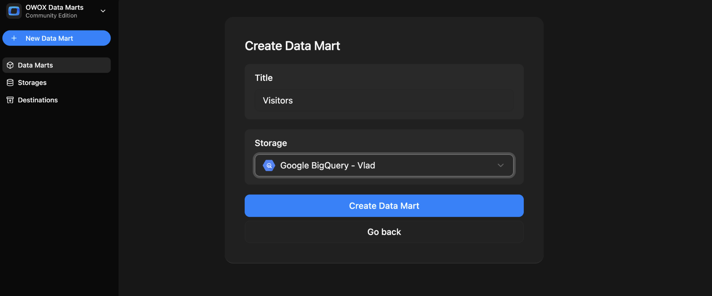
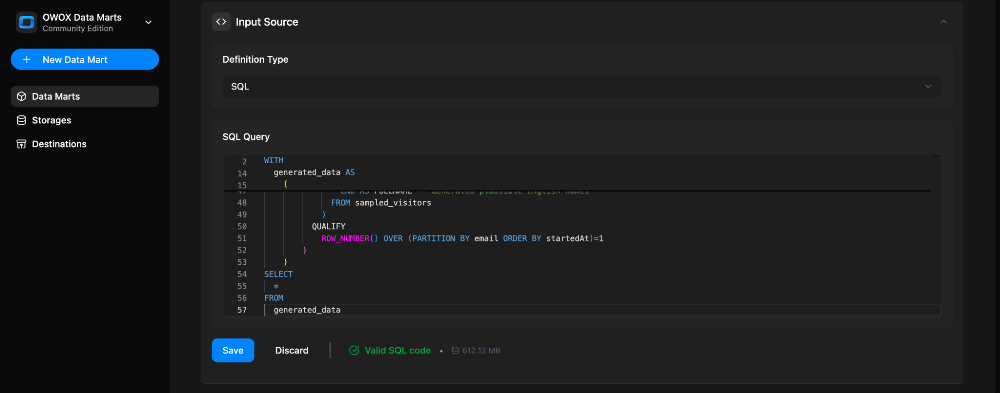
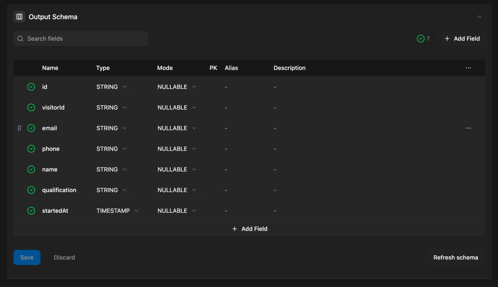
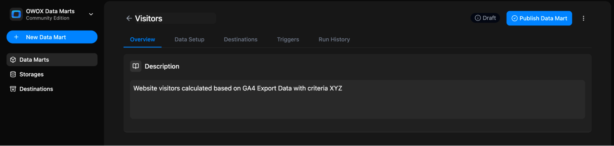
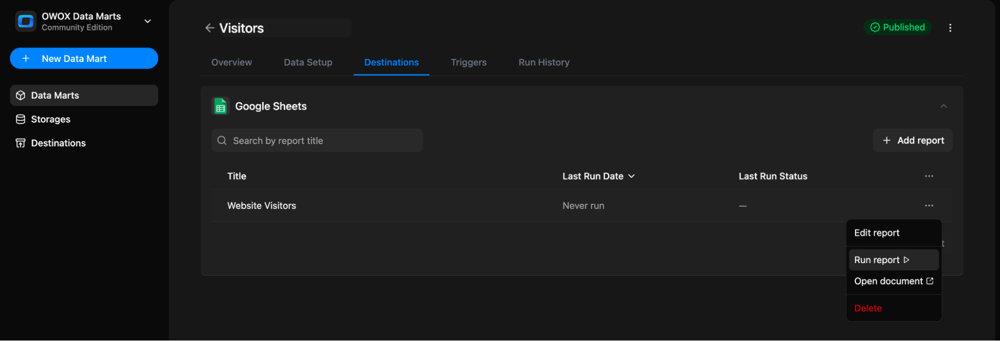

# SQL-based Data Mart

Use this option when you want to define a Data Mart based on a SQL query written manually — using your existing data warehouse tables, joins, and logic.

Note: You need a data storage available for the data mart setup. Here is [how to add a data storage](../../storages/manage-storages.md)

## Step 1: Create a New Data Mart

- Click **+ New Data Mart**
- Give it a descriptive title (e.g., `Visitors`)
- Select your **Data Storage** (Google BigQuery or AWS Athena)
- Click **Create Data Mart**



## Step 2: Choose Definition Type – SQL

In the **Input Source** section, set the **Definition Type** to `SQL Query`.

You’ll now see a SQL editor where you can write or paste your query.

Write a new query or paste an existing one.  
Wait until it’s validated, then click **Save** (and **Publish Data Mart**).

> ✅ **Tip:** Keep your query focused on one specific business question. This helps with reusability and semantic clarity.



You can reference any **table or view** available in your storage.

### Reference another Data Mart

When a Data Mart needs the logic of one you already have — the same orders, only retail ones — reference that Data Mart instead of copying its SQL. When its logic changes, every Data Mart built on it follows, and the two can't drift apart.

Type `@` in the SQL editor and pick a published Data Mart from the same Storage. It's inserted where a table name would go:

```sql
SELECT *
FROM [Orders](dm:96c33880-70e3-4151-9a07-ae379c994898) AS o
WHERE o.order_type = 'Retail'
  AND o.salesChannel != 'Draft Orders'
```

The ID after `dm:` decides which Data Mart is read. The title in brackets is only a label, refreshed from the referenced Data Mart each time you save.

When the query runs, OWOX puts the referenced Data Mart's own SQL in place of the reference — or `SELECT * FROM` its table, for a Data Mart defined by a table, view, pattern or connector. The warehouse receives plain SQL, and **Preview SQL** of a report shows it down to the warehouse tables.


What to know:

- **Same Storage only.** A reference can't point to a Data Mart in another Storage. It isn't available for Legacy Google BigQuery storages.
- **Published Data Marts only**, and only ones you can use in reports. This is checked for every reference each time the query is saved, so to save a query you need access to every Data Mart it references, including ones someone else added. People who read your Data Mart don't need that access, and the referenced SQL is visible to them in **Preview SQL**. Losing access to a referenced Data Mart later doesn't stop the Data Marts already saved with a reference to it.
- **Columns come from the referenced Data Mart's source**: its query or its table. Its Calculated Fields aren't available.
- **A column that keeps its name takes the referenced Data Mart's alias and description.** In your Output Schema they're read-only and change only in the Data Mart they come from, so a business name is written once. To give a column your own alias and description, rename it in your query (`o.amount AS retail_amount`). When several referenced Data Marts have a column of that name, it keeps its own. Primary keys aren't taken over: mark them in your Data Mart.

  

- **A referenced Data Mart must be a single query.** A script with `DECLARE`, `SET` or several statements can't be referenced. If a referenced Data Mart becomes one later, the Data Marts that reference it fail to run until it's a single query again. Its `ORDER BY` doesn't carry over to yours: sort in your own query or in the report.
- **References can be nested up to 10 levels deep**, and a Data Mart can't reference itself, directly or through others.
- **Each reference adds the referenced Data Mart's whole SQL to your query**, and nested references add theirs. A long chain can reach your storage's limit on query length: 256 KB on AWS Athena, 1 MB on Google BigQuery. OWOX stops with an error once the query would grow past 1,000,000 characters.
- **Changing or deleting a referenced Data Mart lists the Data Marts that reference it**, so you can check them first. Their Output Schema isn't refreshed automatically — refresh it after a change that adds or removes columns. Alias and description changes reach them on their own.
- **Preview SQL can show a view name instead of SQL** where OWOX reads a Data Mart through a view it keeps in your storage: a referenced query that uses `WITH RECURSIVE`, and on AWS Redshift, a referenced query with `WITH` placed inside your own `WITH` clause, or a report with output controls or joins on a Data Mart that references others. Creating that view takes permission to create views in your storage, and the first time, to create the dataset or schema that holds them. Everywhere else, a reference only needs permission to run queries.

## Step 3: Define Output Schema

Once the query is saved, the **Output Schema** will be generated automatically.  OWOX will attempt to auto-detect:

- Column names
- Data types



You can:

- Mark **primary keys**
- Add **aliases** (business-friendly column names)
- Add **descriptions** for each field

A field that comes from a [referenced Data Mart](#reference-another-data-mart) under the same name shows that Data Mart's alias and description, read-only.

> 💡 These descriptions improve usability when the data is reused in BI tools or shared with business users.

## Step 4: Add a Description (Optional but Recommended)

Use the **Overview** tab to describe:

- What the Data Mart is about
- What business question it answers
- Any context that might help other users



## Step 5: Add Reports

First, make sure your project has a Destination. If it has none, create one under **Destinations** in the left sidebar — see [Adding a New Destination](../../destinations/manage-destinations.md#adding-a-new-destination). You can also click **Connect Google Sheets** on the Data Mart's empty **Destinations** tab.

Open the **Destinations** tab of your Data Mart.


In your Destination's block, click **+ New Report**.


Then fill in the report form:

1. Give your report a name, e.g. `Website Visitors`
2. Select a destination
3. In **Document Link with Sheet ID (GID)**, paste a link to an existing tab. Or click **+ New Sheet** to create a spreadsheet
4. For an existing spreadsheet, share it with the email shown under **Share document with**, and give it **Editor** access
5. Click **Create & Run report**. To save without running, open the dropdown next to the button and select **Create new report**


You can now:

- Run the report  
- Edit the report  
- Open the document  
- Delete the report



## Step 6: Set Triggers

You can automate the query by setting a **Trigger** to refresh the data on a schedule.

- Go to the **Triggers** tab → Click **+ Add Trigger**
- Choose **Trigger Type**: `Report Run`
- Set schedule:
  - **Daily** → choose time & timezone
  - **Weekly** → select days of the week, time & timezone
  - **Monthly** → select dates, time & timezone
  - **Interval** → e.g., every 15 minutes
- Click **Create trigger**

## Related Links

- [Scheduling reports updates →](report-triggers.md)
- [Adding more report destinations →](../../destinations/manage-destinations.md)
