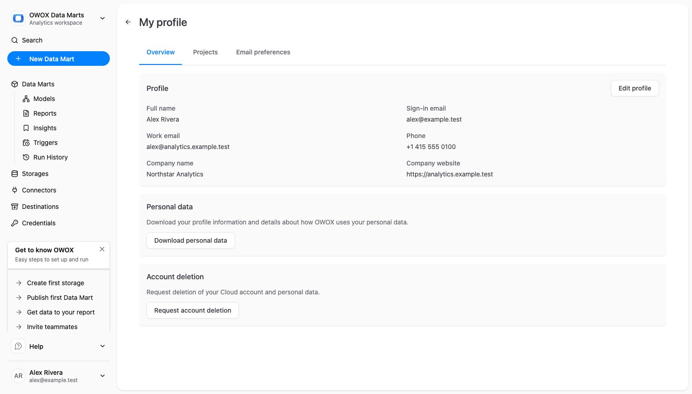
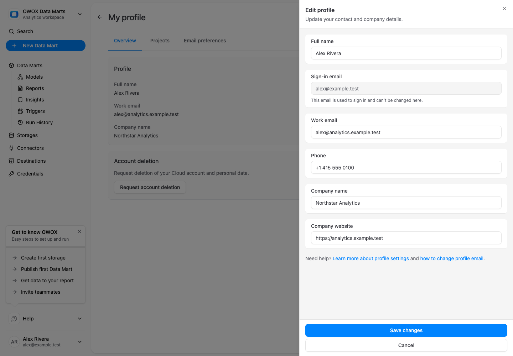
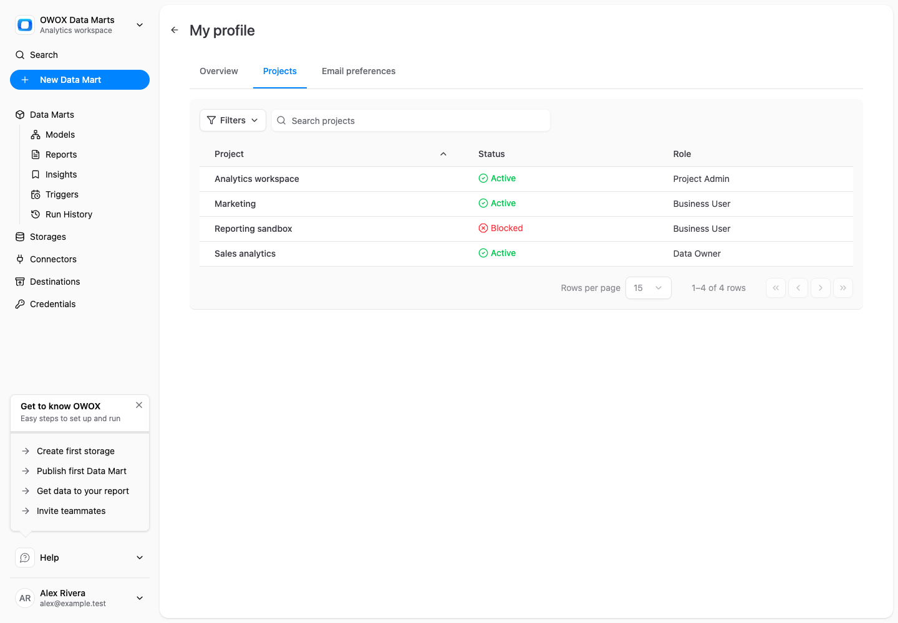
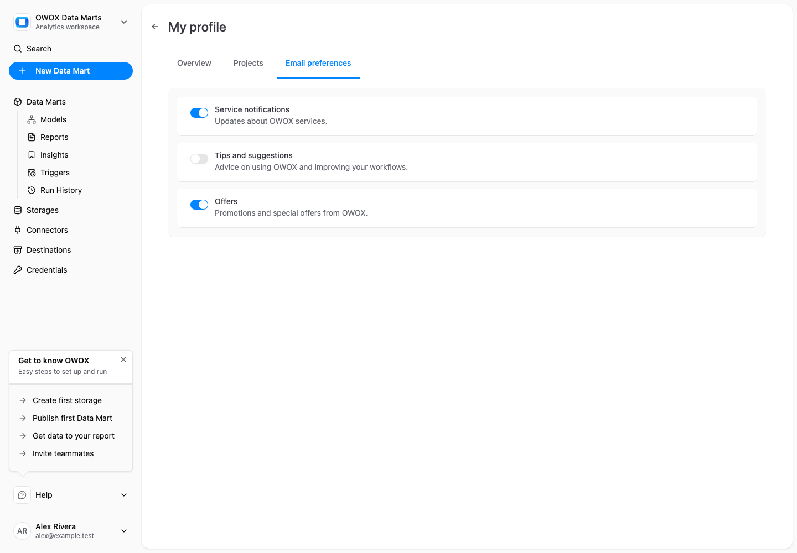
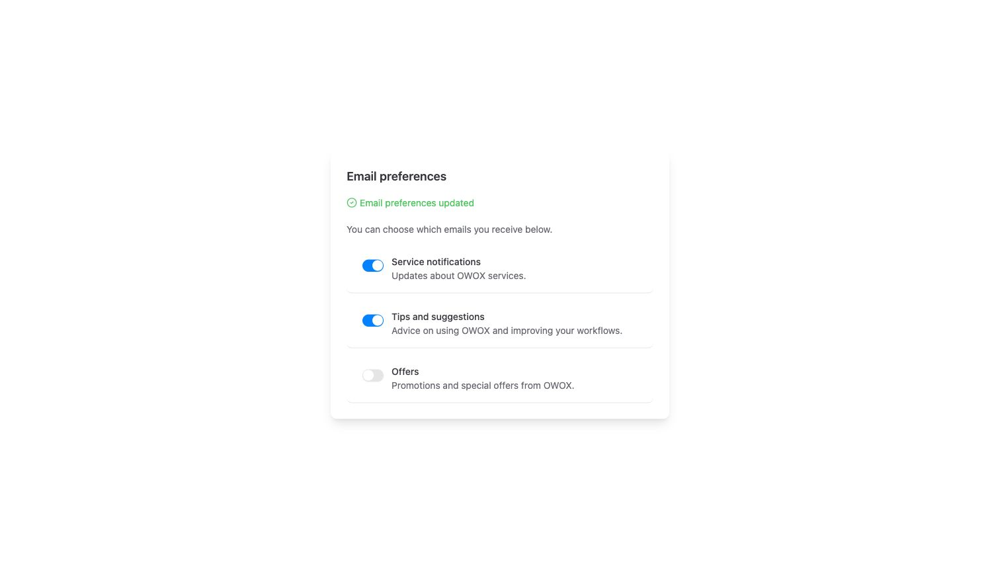

# Project Settings

**Project Settings** is where Project Admins manage the people, permissions, and keys of an OWOX Data Marts project.

## What Project Settings covers

A project is the workspace that holds your [Data Marts](../data-marts/), [Storages](../storages/), [Destinations](../destinations/), and [Reports](../reports/). Project Settings controls who belongs to it and what each person can do.

Every member has one of three roles:

| Role | Access level |
| --- | --- |
| **Project Admin** | Full access across all entities |
| **Data Owner** | Builds and maintains data resources |
| **Business User** | Self-service reporting on shared Data Marts |

Access to a specific resource combines the member's role, their ownership status, and the resource's sharing settings. [Contexts](./contexts.md) add business-domain labels, such as Marketing or Finance. They limit visibility only for members whose **Role scope** is **Selected contexts only**.

Use **Project Settings → Overview → Description** to tell AI assistants your project's business context, terminology, and conventions. The description holds up to 10,000 characters, and only Project Admins can edit it. AI assistants connected through MCP receive it in full through the `get_project_context` tool. See [Add project context for your assistant](../getting-started/setup-guide/mcp.md#add-project-context-for-your-assistant).

## When to use Project Settings

- You invite teammates and assign them roles.
- Different teams should see different subsets of Data Marts, Storages, or Destinations.
- You want a clear owner for each Storage, Destination, and Report.
- A self-managed deployment needs a license key from your Cloud project.

## Get started

1. Open **Project Settings → Members** and invite your team.
2. Assign each member a [role](./roles-and-permissions.md).
3. If teams need scoped visibility, add [Contexts](./contexts.md) and attach them to resources. Then set members' **Role scope** to **Selected contexts only**.

## Learn more

| Need | Read |
| --- | --- |
| Invite, remove, or provision members | [Managing Project Members](./members.md) |
| Understand the three roles in detail | [Roles and Permissions](./roles-and-permissions.md) |
| Control access to specific resources | [Ownership and Sharing](./ownership-and-sharing.md) |
| Scope visibility by business domain | [Contexts](./contexts.md) |
| Connect a self-managed deployment to Cloud | [License Keys](./license-keys.md) |
| Alert the team about run results | [Notification Settings](../notifications/notification-settings.md) |
| Give AI assistants your project's business context | [MCP Server](../getting-started/setup-guide/mcp.md#add-project-context-for-your-assistant) |

## My profile in OWOX Cloud

Open the user menu and select **My profile** to see your name, sign-in email, work email, phone, company name, and company website in OWOX Cloud. The user menu is also available on the **Request access** screen, so you can check which account is signed in while you wait for project access.

On **Overview**, select **Edit profile** to update your contact and company details. Your sign-in email is read-only. The editor includes links to profile settings help and Google's instructions for changing your account email. Under **Account deletion**, you can submit a request to delete your account and personal data. You can cancel a pending request before it is confirmed.

Under **Personal data**, select **Download personal data** to save `user_info.json`. It includes your contact and company details, the sources and purposes of processing your information, and information about third parties. You can download the file while waiting for project access and when viewing an account in read-only mode.

Under **Projects**, you can see which projects you belong to and your role in each one. Search by project name or filter by role or project status.

Under **Email preferences**, turn your personal email topics on or off. Changes apply to your OWOX Cloud account across projects.

### Links from OWOX emails

An unsubscribe link updates the topic named in the email as soon as you open it. The page shows your current email preferences and lets you turn individual topics on or off. You do not need to sign in or select a project. An invalid or expired link shows an error instead of changing your preferences.

A personal-data download link opens a page with **Download personal data**. Select the button to save the file. This signed-link download preserves the information available through the link; it does not include the company fields or account-specific processing purpose from the signed-in export.
