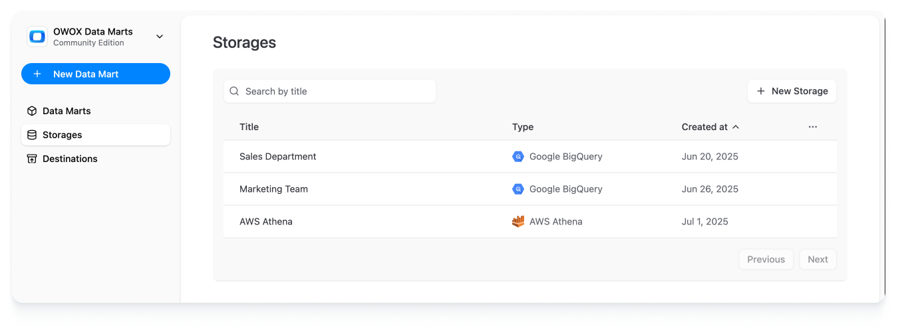

# Storage Management

Storages are specialized Data Sources that provide an SQL interface for querying and caching data.

_IMPORTANT: OWOX Data Marts does not retain your data, ensuring that data ownership, storage, and processing control remain under the control of the Data Analyst._

Each project requires at least one **Storage** to be configured to manage and process your data.

If managing multiple clients or teams, you may also want to have multiple **storage configurations** to isolate access.

## Adding a New Storage

To configure a new **Storage**:

1. Navigate to the **Storages** in the left sidebar and click on **+ New Storage**.
2. Then select the **data warehouse** you want to add and follow the instructions for your platform:
   - [Google BigQuery](supported-storages/google-bigquery.md)
   - [AWS Athena](supported-storages/aws-athena.md)
   - [AWS Redshift](supported-storages/aws-redshift.md)
   - [Snowflake](supported-storages/snowflake.md)
   - [Databricks](supported-storages/databricks.md)
   - Azure Synapse (Coming soon)
3. Fill in the required configuration fields based on the selected data warehouse. Follow the instructions for your platform.
   Select a **Credential** instead of entering a key: see [Credentials for Storages](#credentials-for-storages).
4. Click **Save** to complete storage setup or **Cancel** to finish the configuration later.
   If a value can't be used, **Save** marks the field to fix in red, opens its section, and
   explains what is wrong under the field. The mark clears when you correct the value.

> ☝️ Upon selecting the **+ New Storage** button and specifying the desired storage type, a Storage entry is created.
> You can create **Data Mart** entities and model a data structure for your project prior to configuring the **Storage**.  
> Note that **Data Mart** cannot be validated or published until the associated **Storage** is fully configured.

---

## Credentials for Storages

A Storage does not hold its own key. It selects a [Credential](../project/credentials.md), and one
Credential can serve several Storages, so a rotated key is replaced once.

- The **Credential** field lists the Credentials that fit the Storage type, that you can use and that
  are enabled (a disabled one stays shown only on the Storage already using it).
  **+ Create new Credential** opens the Credential form beside the Storage form; saving it selects
  the new Credential. If exactly one Credential fits a new Storage, it is selected for you.
- A Storage shows when its Credential cannot be used: **Credential disabled**, **Reconnect the
  Credential**, or **Reconnect the Credential to grant permissions**. Fix it on the Credential;
  the Storage works again. **Google sign-in is not configured on this server** means the
  deployment has no Google OAuth set up, so Storages that use a BigQuery Google account Credential
  do not run until an administrator sets it up.
- If you can edit a Storage but cannot see its Credential, the field shows **Restricted
  Credential**. You can switch the Storage to a Credential you can use, but you cannot open or
  change the one it has. When that Credential cannot be used, the Storage says to ask the
  Credential's owner to enable or reconnect it.
- Running a Storage, its Data Marts and reports needs access to the Storage only, not to its
  Credential. A run that fails because of the Credential says what is wrong with "this Storage's
  Credential" and does not name it. In the Storage lists and forms the same failure appears as the
  Storage's state, worded for the member's access.
- A Storage that has no Credential yet shows **Uses its own key until you select a Credential**
  under the field. Saving it without selecting a Credential keeps that key. Selecting
  a Credential switches the Storage to it.
- **Copy credentials from another storage** is gone: select the same Credential in both Storages.
- Storages that had a key before this change are converted once, on the first start of this
  version (or when the operator runs migrations). Identical keys of Storages with the same owners
  become one Credential, which keeps the Contexts all its Storages shared. Every owner of those
  Storages, Business Users included, owns the Credential. Converted Credentials are Not shared:
  members who run or maintain a Storage without owning it keep doing so, but an owner has to
  share the Credential for use before they change where the Storage connects (project, region,
  account or host) or reuse its key elsewhere, and for maintenance before they replace its key.
  A Storage whose key cannot be converted keeps running on its own key until you select a
  Credential.

---

## Removing a Storage

To remove an existing **Storage** configuration:

1. Ensure all associated **Data Marts** linked to this **Storage** are deleted first. To do this:
   - Navigate to the **Data Marts** page in the OWOX Data Marts web application.
   - Identify and select all Data Marts associated with the Storage you intend to remove.
   - Click the **Delete** button above the Data Marts table and confirm the deletion.
2. Go to the **Storages** page via the main navigation pane.
3. Locate the **Storage** you want to delete in the table, click the item actions menu (represented by **...**), and click **Delete**.
4. Confirm the deletion to remove the Storage.

> ☝️ Attempting to delete a **Storage** with associated Data Marts will result in the error: "Cannot delete the storage because it is referenced by existing data marts".  
> Ensure all dependencies are removed before proceeding.

---

## Managing Owners

Each Storage has an **Owners** list — the team members responsible for its configuration.

- When a new Storage is created, the **creator is automatically assigned as an owner**.
- You can add or remove owners in the Storage configuration sheet (the **Owners** field in the General section).
- Only project members can be assigned as owners.
- Owners are saved together with the rest of the Storage configuration when you click **Save**.
- You can filter Storages by owner in the list view using the **Owners** filter.

> ☝️ Ownership is currently informational — it does not affect access control. Any user with edit access can modify any Storage regardless of ownership.

---

## Key Considerations

- Each **Data Mart** requires a single **Storage** association. Verify your selection during **Data Mart** setup.
- For additional guidance or troubleshooting, explore the supported **Storage** configuration pages or join the [OWOX Community](https://github.com/OWOX/owox-data-marts/discussions).
