# How to Import Data from the Linkedin Ads Source

Before proceeding, please make sure that:

- You have created a **refresh token** (as described in [CREDENTIALS](CREDENTIALS)) and securely saved your **Client ID** and **Primary Client Secret**.  
- You have [set up **OWOX Data Marts**](https://docs.owox.com/docs/getting-started/quick-start/) and created at least one storage in the **Storages** section.  

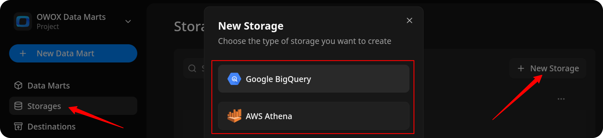

## Create the Data Mart

- Click **New Data Mart**.
- Enter a title and select the Storage.
- Click **Create Data Mart**.

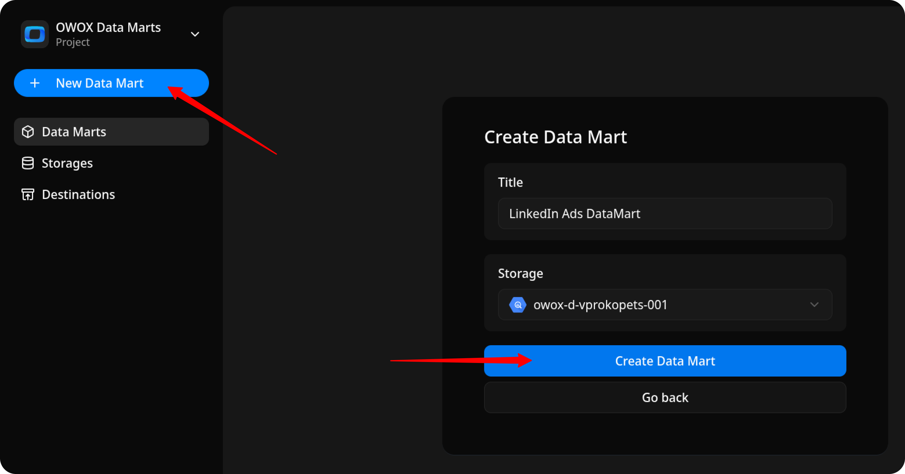

## Set Up the Connector

1. Select **Connector** as the input source type.
2. Click **Set up connector** and choose **LinkedIn Ads**.  
3. Fill in the required fields:
    - **Client ID** – paste the ID you saved earlier.
    - **Primary Client Secret** – paste the secret you saved earlier.
    - **Refresh Token** – paste the token you created following the [CREDENTIALS](CREDENTIALS) tutorial.
    - **Account URNs** – you can find this value on your [LinkedIn Campaign Manager](https://www.linkedin.com/campaignmanager/).
    - Leave the other fields as default and proceed to the next step.

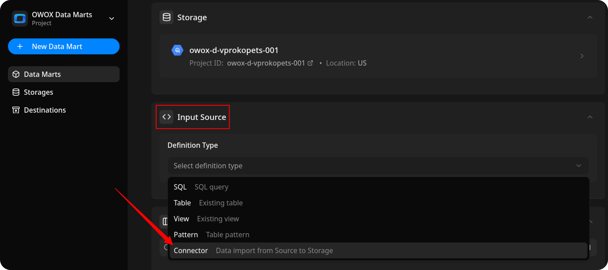

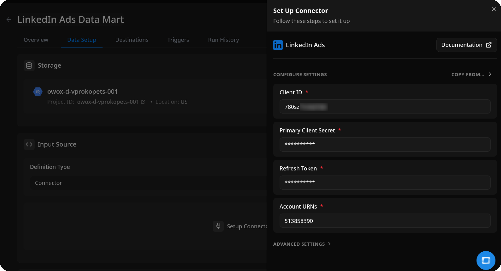

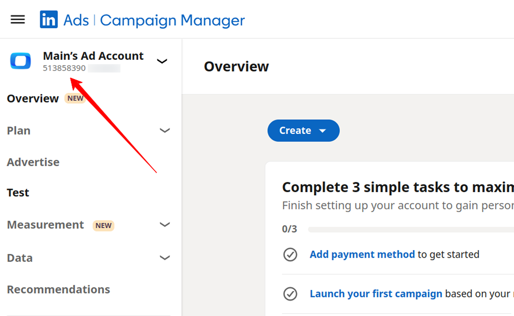

## Configure Data Import

1. Choose one of the available **endpoints**.  
2. Select the required **fields**.  
3. Specify the **dataset** where the data will be stored (or leave the default).  
4. Click **Save**, then **Publish & Run Data Mart**. Publishing starts the first import automatically.

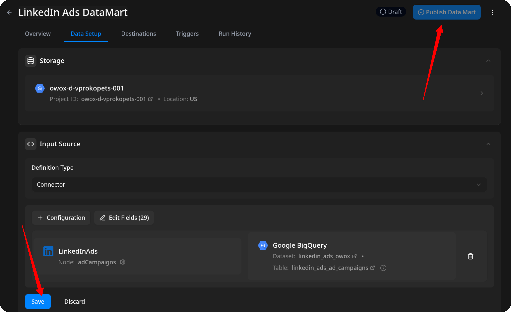

## Run the Data Mart

**Publish & Run Data Mart** already started the first import. To import data again, you have two options:  

Option 1: Import Current Day's Data

Choose **Manual run → Incremental load** to load data for the **current day**.

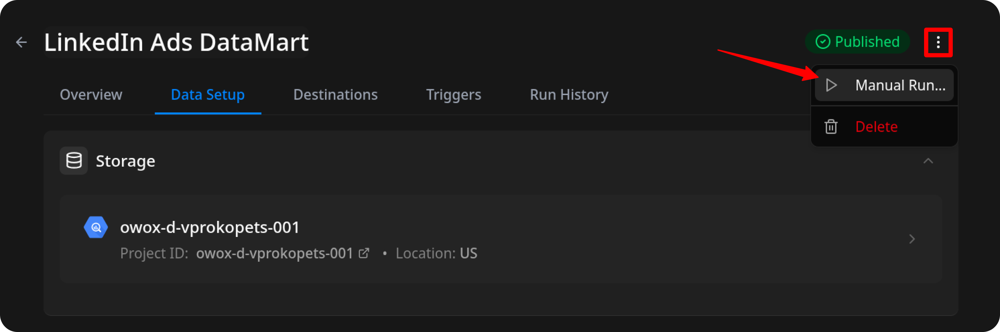

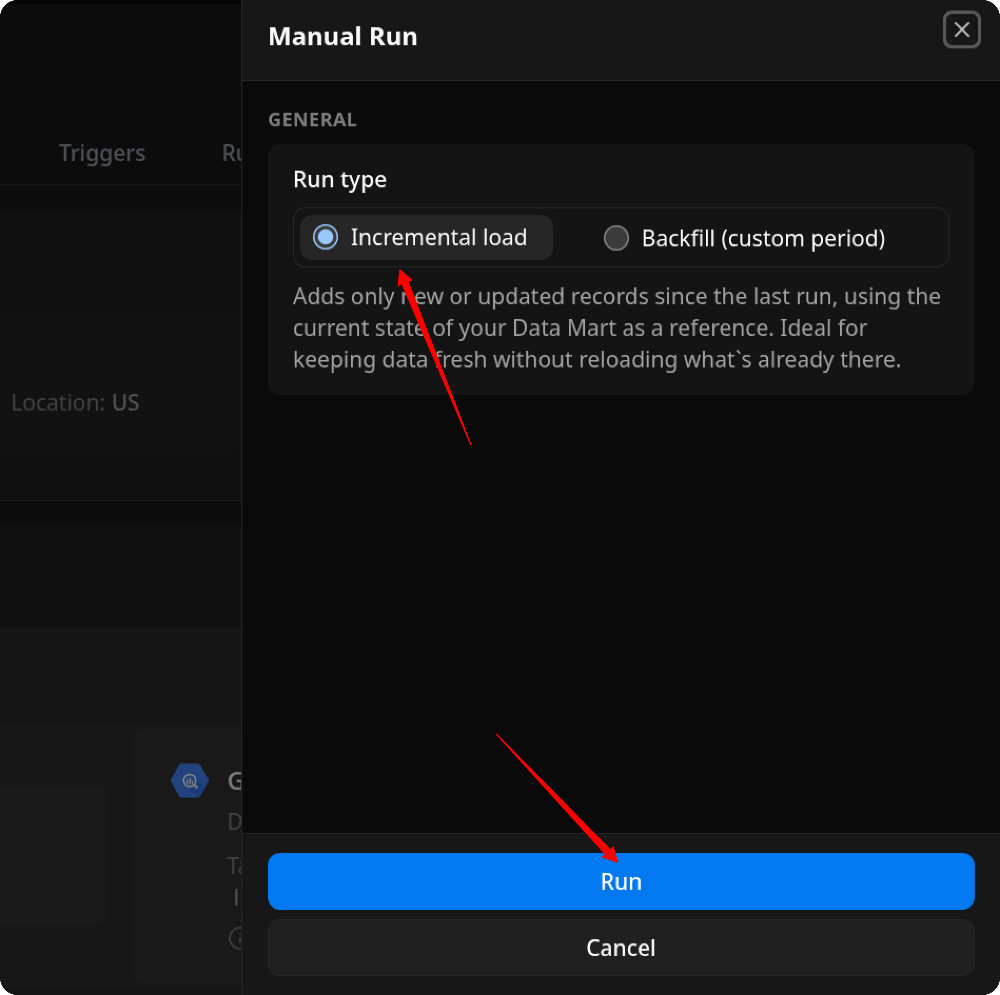

> ℹ️ If you click **Incremental load** again after a successful initial load,  
> the connector will import: **Current day's data**, plus **Additional days**, based on the value in the **Reimport Lookback Window** field.

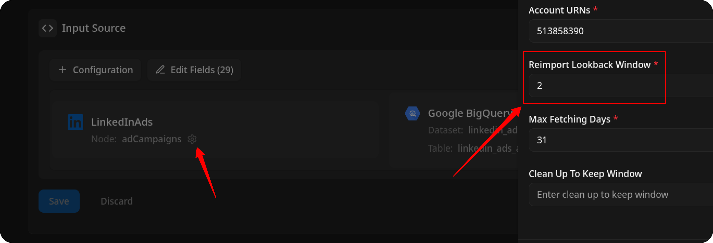

Option 2: Manual Backfill for Specific Date Range

Choose **Backfill (custom period)** to load historical data.  

1. Select the **Start Date** and **End Date**.
2. Click the **Run** button.

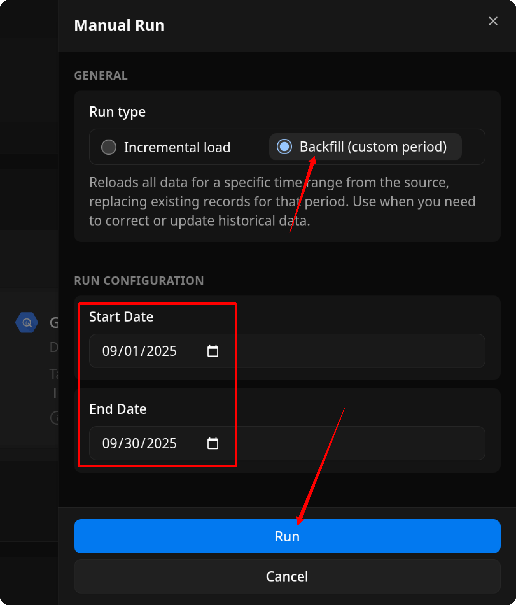

The process is complete when the **Run history** tab shows the message:  
**"Success"**  

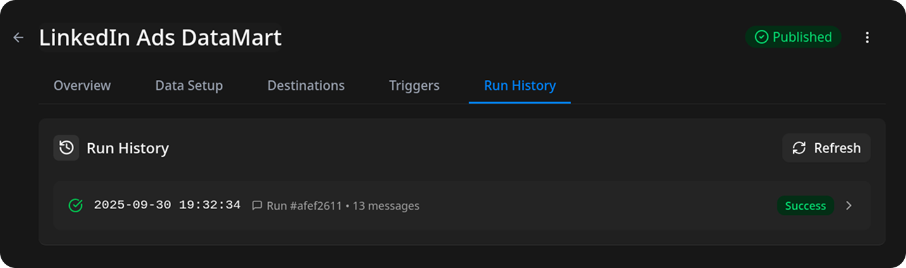

## FAQ

### How do I see spend by country, region, or county?

Choose one of these endpoints:

- **Ad Analytics by Country** – table `linkedin_ads_ad_analytics_by_country`
- **Ad Analytics by Region** – table `linkedin_ads_ad_analytics_by_region`
- **Ad Analytics by County** – table `linkedin_ads_ad_analytics_by_county`

Each row holds one campaign's metrics for one location on one day. The location comes as a LinkedIn URN (for example `urn:li:geo:103644278`) and as its English name (for example `United States`). The `campaign` column holds the campaign URN; its number is the `id` in the **Campaigns** endpoint.

LinkedIn reports one location level at a time, so country, region, and county are separate endpoints and separate tables.

What to expect from these endpoints:

- **More API requests than Ad Analytics.** LinkedIn breaks location down only for one campaign at a time. For every day, the connector first reads which campaigns ran, then asks for each of those campaigns separately. LinkedIn returns up to 18 metrics per request, so every further 18 selected metrics add one more request per campaign.
- **Totals can be lower than in Ad Analytics.** LinkedIn drops a location with fewer than 3 events, returns at most the top 100 locations for each ad on each day, and returns location data only for ads that reached enough members, to protect member privacy. Rows LinkedIn returns without a location are not imported, and the run says how many.
- **Data arrives 12–24 hours late.** The default **Reimport Lookback Window** of 2 days re-imports those days on the next run.
- **Two years of history.** LinkedIn keeps location breakdowns for two years, so a backfill further back returns no rows.
- **Some metrics are missing.** LinkedIn does not break down `approximateMemberReach`, `audiencePenetration`, `conversionValueInLocalCurrency`, or the carousel card metrics by location, so these endpoints do not offer them.

Location names:

- If LinkedIn returns no name for a location, its name column stays empty, and the run finishes with a **Warning** status that lists those locations.
- If LinkedIn refuses the name lookup, the run imports the metrics and the location URNs, leaves every name empty, and finishes with a **Warning** status.
- If the name lookup fails for a while (for example LinkedIn is overloaded), the affected days are not imported and the run fails, so the next run imports them again with their names.

### Why does my Ad Analytics run finish with a Warning status?

LinkedIn's `adAnalytics` endpoint does not support pagination and caps each response at **15,000 rows**. To avoid silently losing data on long date ranges, the connector fetches analytics **one day at a time**. A single day can still exceed the limit, for example an account with more than 15,000 active creatives. The run then finishes with a **Warning** status and lists the affected days in the log. Data for those days may be incomplete.

## Access Your Data

Once the run is complete, the data will be written to the dataset you specified earlier.

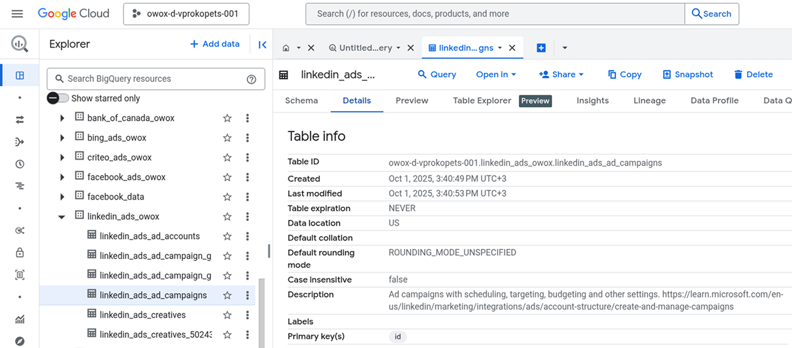

If you encounter any issues:

1. Check the Run history for specific error messages
2. Please [visit Q&A](https://github.com/OWOX/owox-data-marts/discussions/categories/q-a) first
3. If you want to report a bug, please [open an issue](https://github.com/OWOX/owox-data-marts/issues)
4. Join the [discussion forum](https://github.com/OWOX/owox-data-marts/discussions) to ask questions or propose improvements
