# How to obtain the credentials for the Microsoft Ads source

During this process, you will obtain the following credentials required for the Microsoft Ads source:

- **Account ID**  
- **Customer ID**  
- **Developer Token**  
- **Client ID**  
- **Client Secret**  
- **Refresh Token**

## If You Sign In to Microsoft Advertising with Google

Microsoft Advertising accepts API requests only with the sign-in type you use on its website. If you sign in with Google, a Microsoft sign-in with the same email fails with error `126 IdentityTypeMismatch`.

- If the Credential form offers **Sign in with Google**, click it and choose the Google account you use for Microsoft Advertising. Then you need only the **Account ID** and **Customer ID** from Step 6.
- To enter the values by hand, use a Google OAuth client instead of the Microsoft app in Steps 1–5:
  1. In the [Google Cloud Console](https://console.cloud.google.com/apis/credentials), create an OAuth client of type **Desktop app**. Copy its **Client ID** and **Client Secret**.
  2. Open this address in the browser, with your Client ID in place of `YOUR_CLIENT_ID`, and sign in with the Google account you use for Microsoft Advertising:

     ```text
     https://accounts.google.com/o/oauth2/v2/auth?client_id=YOUR_CLIENT_ID&redirect_uri=http://127.0.0.1:8080&response_type=code&scope=openid%20email%20profile&access_type=offline&prompt=consent
     ```

  3. Google then opens `http://127.0.0.1:8080/?code=...`. The page does not load, which is expected. Copy the value of `code` from the address bar.
  4. In ReqBin or Postman, send a `POST` request to `https://oauth2.googleapis.com/token` with the form fields `code`, `client_id`, `client_secret`, `redirect_uri=http://127.0.0.1:8080` and `grant_type=authorization_code`. The response holds the **Refresh Token**.
  5. Enter the Google client's **Client ID** and **Client Secret**, the **Refresh Token**, and your **Developer Token** from Step 7. The connector recognizes a Google client by its ID, which ends with `.apps.googleusercontent.com`.

**Before you start:** Sign up for [ReqBin](https://reqbin.com/) or [Postman](https://www.postman.com/) if you don't have an account yet. Both are free tools for sending API requests. You'll use one of them in Steps 3–5 to obtain the Refresh Token.

## Step 1: Register an App in Microsoft Azure

If you haven't already, [sign up for Microsoft Azure](https://azure.microsoft.com/) and log in to the [Azure Portal](https://portal.azure.com/).

In the Azure Portal, search for and open the **App registrations** service.

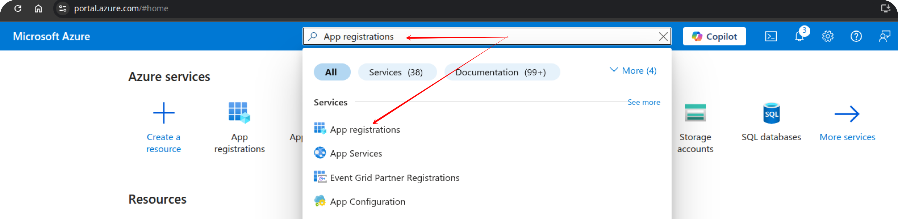

Click **New registration** and fill in the form:

- **Name**: Choose a name for your app.  
- **Supported account types**:  
  Select:  
  _Accounts in any organizational directory (Any Microsoft Entra ID tenant – Multitenant) and personal Microsoft accounts (e.g., Skype, Xbox)_
- **Redirect URI**:  
  - Platform: _Web_  
  - URI: `http://localhost:8080`
  
Click the **Register** button.

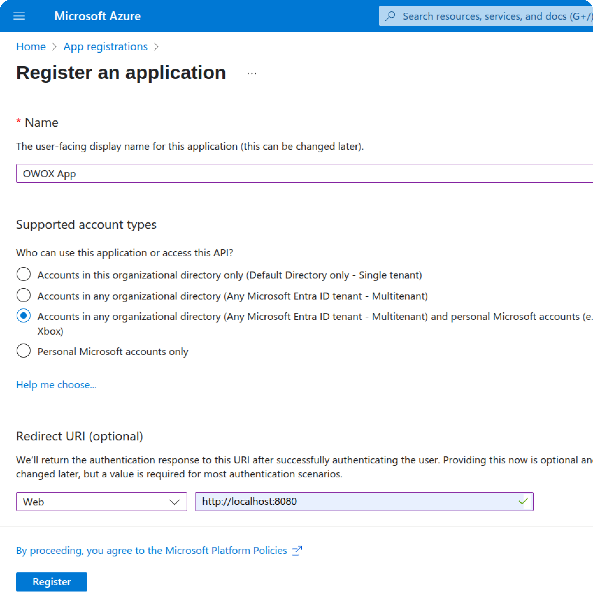

## Step 2: Generate Client Credentials

First, copy and save your **Client ID**:

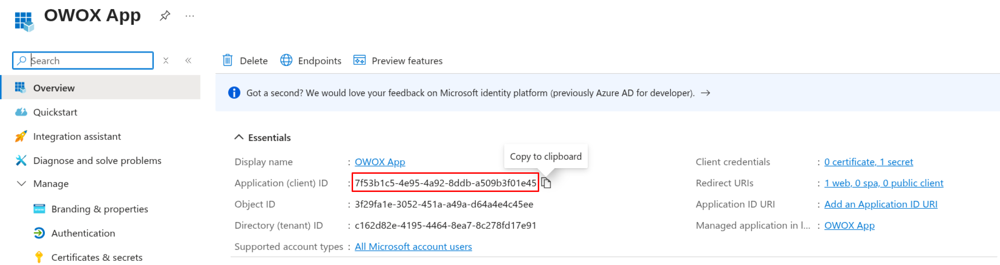

Then, go to **Client credentials** -> **Add a certificate or secret**.

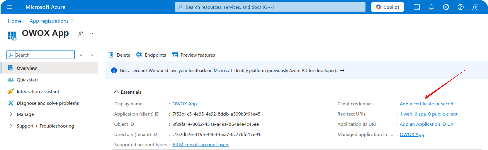

Click **New client secret**.

Provide a description (e.g., _Client secret for OWOX App_), choose the maximum expiration period (_730 days_), and click **Add**.

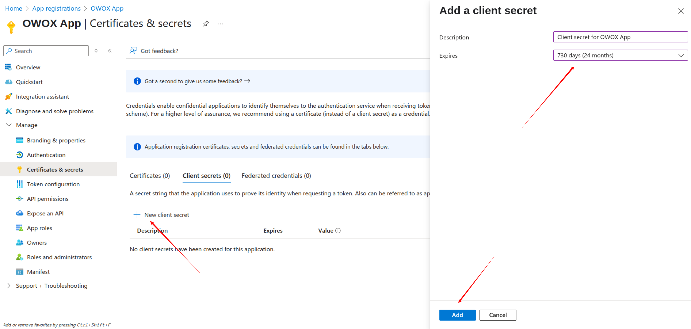

> ⚠️ **Important:** Copy and securely save the **client secret value**. You won't be able to see it again later.

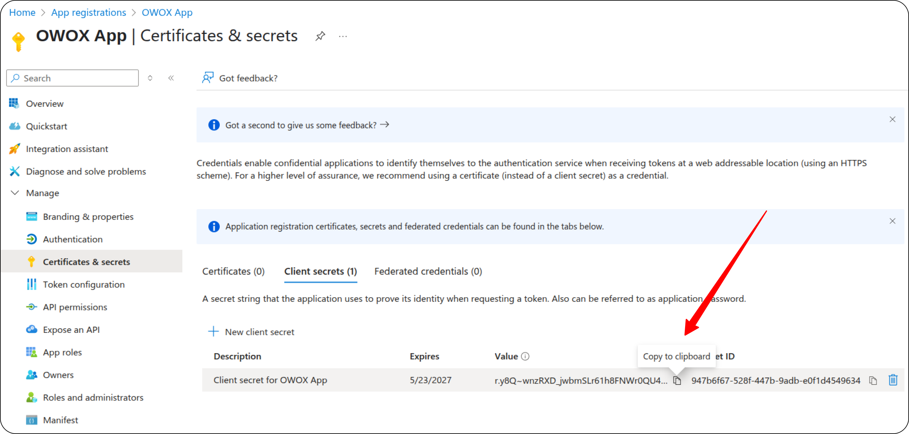

At this point, you have:

- **Client ID**
- **Client Secret**
- **Redirect URI**: `http://localhost:8080`

## Step 3: Prepare for Authentication

Use [ReqBin](https://reqbin.com/) or **Postman** to build a POST request. This request exchanges the authorization code for a refresh token. Send it to:

``` code
https://login.microsoftonline.com/common/oauth2/v2.0/token
```

Open the **Body** tab. Set the body type to **x-www-form-urlencoded**. In ReqBin, choose **Form** as the content type. Add these parameters, replacing _YOUR_CLIENT_ID_, _YOUR_CLIENT_SECRET_, and _YOUR_AUTHORIZATION_CODE_ with real values:

> **Note:** You'll get the **Authorization Code** from the URL in Step 4. Prepare the request now. The code is short-lived, so a ready request lets you paste and send right away.

``` code
client_id=YOUR_CLIENT_ID&
client_secret=YOUR_CLIENT_SECRET&
grant_type=authorization_code&
code=YOUR_AUTHORIZATION_CODE&
redirect_uri=http://localhost:8080&
scope=https://ads.microsoft.com/msads.manage offline_access
```

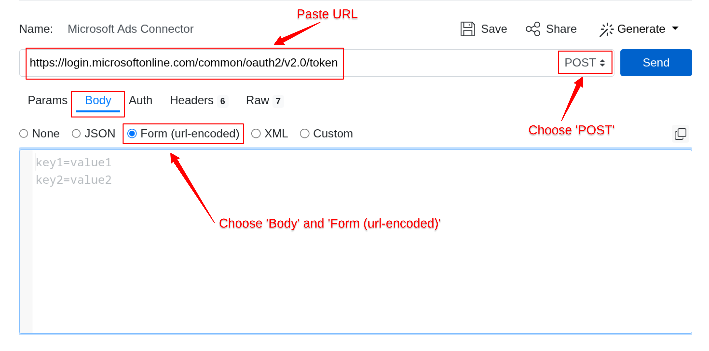

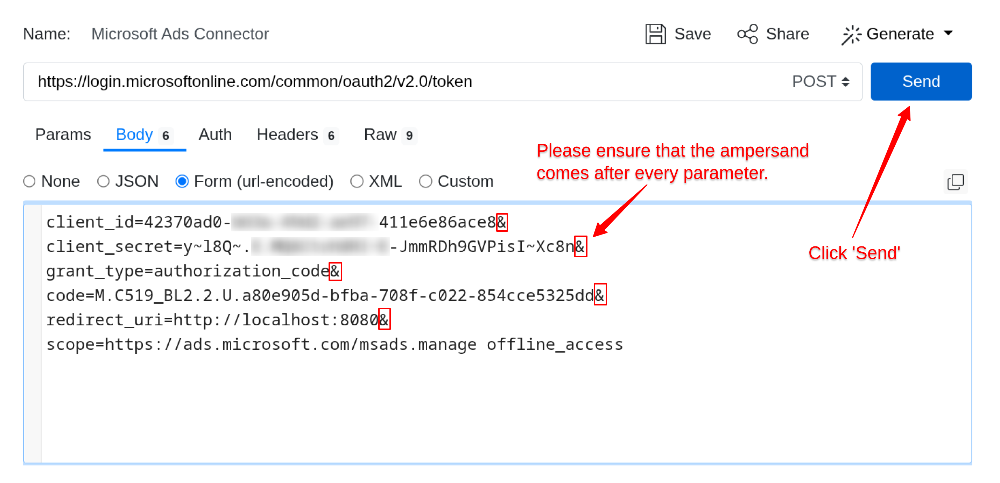

## Step 4: Get the Authorization Code

Create a URL by replacing `CLIENTID` with your **Client ID**:

``` code
https://login.microsoftonline.com/common/oauth2/v2.0/authorize?client_id=CLIENTID&response_type=code&redirect_uri=http://localhost:8080&scope=https://ads.microsoft.com/msads.manage offline_access
```

Open the URL in your browser. Log in and authorize the app by clicking **Accept**. After authorization, you will be redirected to:  
`http://localhost:8080/?code=YOUR_AUTHORIZATION_CODE`  

> ⚠️ **Important:** Sign in with the Microsoft Advertising user that can access the **Account ID** and **Customer ID** you collect in Step 6. The Refresh Token represents this signed-in user, so the connector can only import accounts that this user can reach.

Copy the `code` value from the URL.

> Example:  
> If the redirect URL is:  
> `http://localhost:8080/?code=M.C519_BAY.2.U.0a895e39-774a-e677-b4bb-8589ce3e0beb`  
>Your **Authorization Code** is:  
>`M.C519_BAY.2.U.0a895e39-774a-e677-b4bb-8589ce3e0beb`

## Step 5: Exchange the Authorization Code for a Refresh Token

In ReqBin or Postman, paste the authorization code from Step 4. Click **Send**. A successful request returns a **Refresh Token** in the response. Store it securely — you'll enter it in a Credential (on the **Credentials** page, or with **+ Create new Credential** beside the Data Mart's **Credential** field) to authenticate API requests.

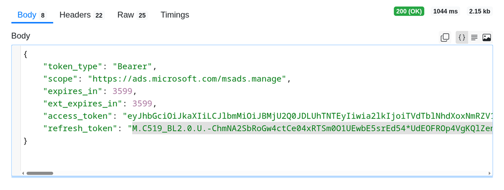

## Step 6: Get Account ID and Customer ID

1. Go to [https://ads.microsoft.com/](https://ads.microsoft.com/) and log in to your Microsoft Ads account.
2. Switch to the account you want to import and open the Campaigns page.
3. Copy the numeric IDs from the browser URL:
   - Use the `aid` value as **Account ID**.
   - Use the `cid` value as **Customer ID**.

> Important: Microsoft Ads also shows account and customer numbers in some places. Those values can be alphanumeric, like `A00000A0AA`. Don't use them here. The connector needs the numeric API IDs from `aid` and `cid`.

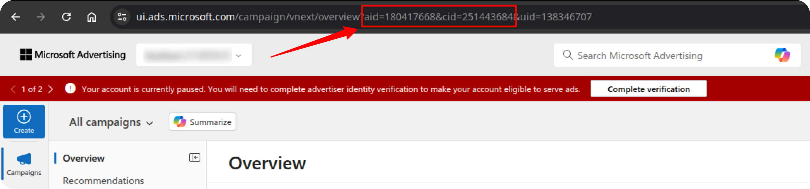

## Step 7: Get Your Developer Token

In the Microsoft Ads interface, go to **Settings → Developer Settings**.

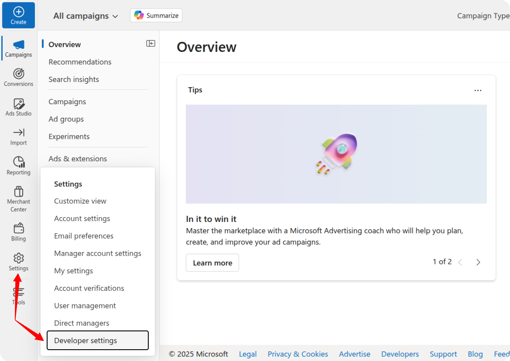

Click **Request Token**, and copy the generated **Developer Token**.

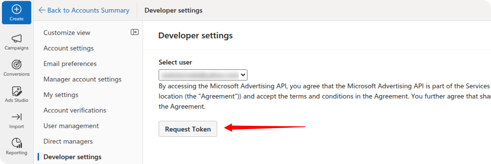

## ✅ Final Summary

At this point, you should have the following credentials:

- **Account ID**  
- **Customer ID**  
- **Developer Token**  
- **Client ID**  
- **Client Secret**  
- **Refresh Token**

These credentials are required to [connect to the Microsoft Ads source](GETTING_STARTED) and begin importing your advertising data.

## Troubleshooting Refresh Token Errors

If you encounter any errors while obtaining the refresh token, check the possible causes and recommended solutions below.

### Error: `Invalid client secret provided. Ensure the secret being sent in the request is the client secret value, not the client secret ID, for a secret added to app '(YOUR APP ID)'`

**Cause:**  
You are using the **Secret ID** instead of the **Secret Value** in your request.  
Only the **Secret Value** can be used to authenticate your app — the **Secret ID** will not work.

**Solution:**  

1. Return to **Step 2** and confirm that you copied the **Secret Value**, not the **Secret ID**.  
2. If the Secret Value is no longer visible (it is shown only once), create a **new Client Secret** in your app and copy the value immediately.  

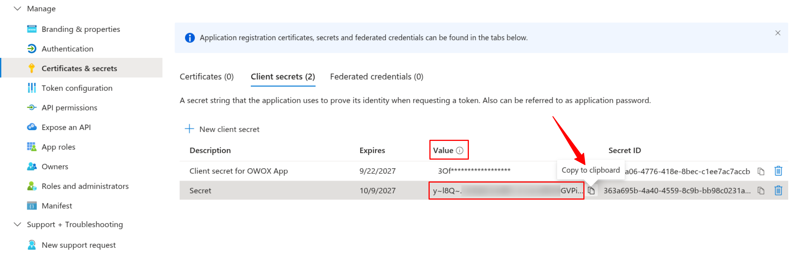

### Error: `The provided value for the 'code' parameter is not valid. The code has expired.`

**Cause:**  
The temporary authorization code has expired.  
Microsoft (and other platforms) issue short-lived authorization codes that must be exchanged for tokens within a limited time window (usually just a few minutes).

**Solution:**  
Repeat **Step 4** to obtain a new temporary authorization code and retry the request.

---

✅ **Tip:**  
Always generate and use the authorization code **immediately** after receiving it to avoid expiration issues.

## Troubleshooting Sign-In Type Errors

### Error: `126 IdentityTypeMismatch` (`You must use a different identity type to sign in to Bing Ads with the same email.`)

**Cause:**  
The Credential was signed in with a different type than the one you use for Microsoft Advertising: Microsoft instead of Google, or the other way around.

**Solution:**  
Reconnect the Credential with the other button: **Sign in with Google** if you sign in to Microsoft Advertising with Google, **Sign in with Microsoft** otherwise. For values entered by hand, see [If You Sign In to Microsoft Advertising with Google](#if-you-sign-in-to-microsoft-advertising-with-google).

## Troubleshooting and Support

If you encounter any other issues:

1. Please [visit Q&A](https://github.com/OWOX/owox-data-marts/discussions/categories/q-a) first
2. If you want to report a bug, please [open an issue](https://github.com/OWOX/owox-data-marts/issues)
3. Join the [discussion forum](https://github.com/OWOX/owox-data-marts/discussions) to ask questions or propose improvements
